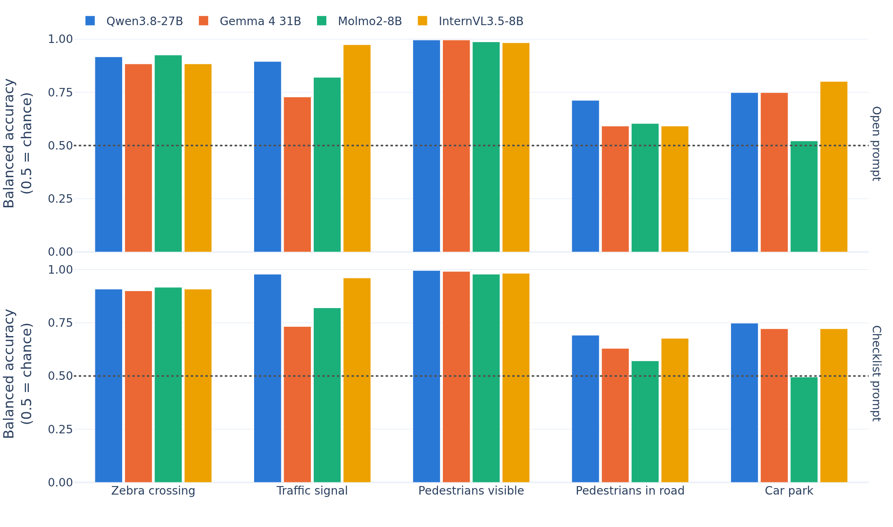
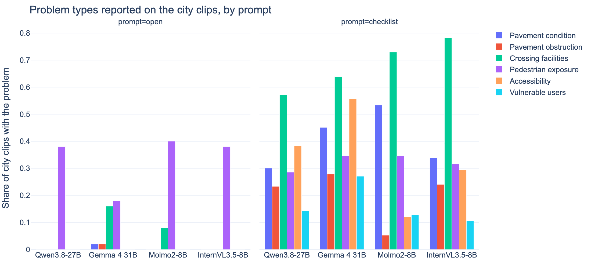
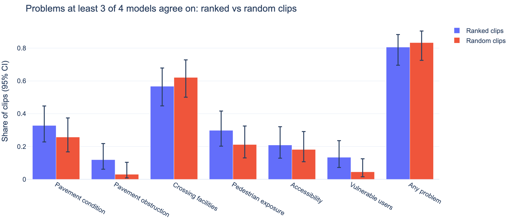
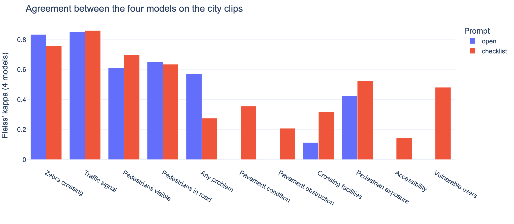
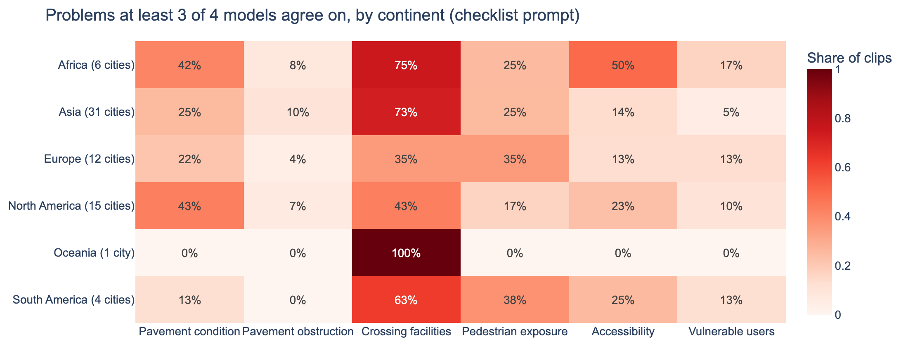
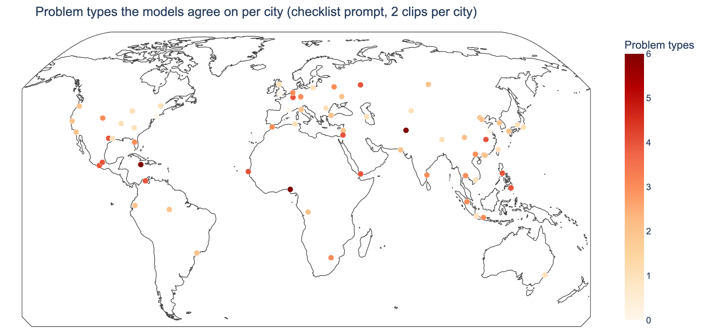

# VLM Street Audit

Using vision-language models (VLMs) to analyse real-world street footage, identify
pedestrian-related problems, localise them in the scene, and suggest street improvements.

## Background

The original concept was a browser-based interface in which people pause street footage,
mark a location in the frame, and describe an observed pedestrian issue and a possible
intervention. The project has since moved away from human participants: the task is now
carried out entirely by VLMs/LLMs.

## Goal

Given street footage, a VLM should:

1. **Detect** pedestrian or infrastructure issues (e.g. missing or blocked pavements,
   unsafe crossings, poor visibility, conflicts with vehicles).
2. **Localise** each issue in the frame (timestamp + bounding box or point).
3. **Describe** the issue in plain language.
4. **Suggest** a concrete improvement or intervention.

## On-device models only

All model inference runs locally (e.g. Hugging Face `transformers` or Ollama).
No cloud APIs: footage and frames never leave the machine.

### Models (RTX 5090, 32 GB)

Several VLMs from different developers do the same task on the same frames, one
model at a time. Details and checkpoints in [`configs/models.toml`](configs/models.toml).

| Model | Developer | Run as | Weights | Why it is in the set |
|---|---|---|---|---|
| Qwen3.8-27B | Alibaba | 4-bit (W4A16) | ~17 GB | Newest and strongest general model; images and video |
| Gemma 4 31B | Google | 4-bit (Google's QAT) | ~19 GB | Second large model from another lineage; detection and pointing |
| Molmo2-8B | Ai2 | BF16 | ~18 GB | Localisation specialist (points, video tracks); open training data |
| InternVL3.5-8B | Shanghai AI Lab | BF16 | ~17 GB | Fourth lineage; an older baseline |

- 27-31B models do not fit 32 GB in BF16 (~55-62 GB), so they run as 4-bit checkpoints.
- Served with vLLM (Linux/WSL2, CUDA 12.8+ for Blackwell) on localhost through its
  OpenAI-compatible API, so one client works for every model. Ollama works too, but its
  GGUF quantisations and image resizing differ per model, which makes coordinates harder
  to compare.
- Fixed per run: frames, prompt, image resolution, temperature 0, and each model's
  checkpoint revision.

## Research questions (draft)

- How well can VLMs identify and localise pedestrian-related problems in real-world street footage?
- How plausible, specific, and actionable are the improvement suggestions they generate?
- How consistent are these observations across models, prompts, and repeated runs?
- Can VLMs (or LLM judges) review, correct, or refine each other's observations, standing in for the human review step?

## Results (first full run, 27 October 2026)

**Status.** The four models answered two clip sets with the main *checklist* prompt:

- **JAAD:** 120 clips with labels, 60 with a zebra crossing and 60 without.
- **Cities:** 150 clips, 2 from each of the 75 sampled cities: the best-ranked snippet and the random one.

Of the 1,080 requests, 25 timed out; they will be rerun. For the city tables below this leaves 133 clips that all four models answered.

The older *open* prompt ("list up to five problems") is still running on the 50 cities added later. Where it is compared below, it covers the first 25 cities (50 clips). All numbers come from `scripts/analyse.py`. Its tables are in `outputs/vlm/analysis/`. Intervals are Wilson 95% intervals. *Consensus* means at least 3 of the 4 models agree.

### Main findings

1. **Scene facts are reliable on JAAD.**
   - All four models spot zebra crossings with a balanced accuracy of 0.90–0.91, and visible pedestrians with 0.98–1.00.
   - They find "pedestrians walking in the road" less well (0.57–0.69). JAAD's crossing label only gives a lower bound for this.
   - Car parks score about 0.72, except Molmo2, which is at chance.
2. **Only Qwen3.8 localises reliably.**
   - With the checklist prompt, 83% (76–89%) of Qwen's points for pedestrian problems land on a labelled pedestrian. Gemma 4's do 41% of the time.
   - Molmo2 and InternVL3.5 mostly give placeholder points rather than looking. Molmo2 uses 8 distinct points for 235 problems; 186 of InternVL3.5's 261 points are round hundreds.
   - Points from these two models should not be used.
3. **The checklist prompt fixes the collapse onto one problem type.**
   - With the open prompt, the models used 1–4 of the 6 problem types (mostly *pedestrian exposure*) and reported problems only where people were visible.
   - With the checklist, every model uses all 6 types. Pavements are judged "absent" on 12–34% of sides instead of almost always "unclear". Empty streets are audited too.
   - Agreement between the models on the problem types rises. For example, Fleiss' kappa for pavement condition goes from −0.01 to 0.36, and for crossing facilities from 0.11 to 0.32.
4. **Missing or poor crossing facilities are the most common problem.**
   - Each model flags them on 57–78% of the city clips.
   - At least 3 of 4 models agree on them for about 60% of clips. They are reported far more often in Asia and Africa (73–75%) than in Europe and North America (35–43%).
5. **Most streets show some problem, chosen or not.**
   - On the ranked snippets, at least 3 models agree on at least one problem in 81% (70–88%) of clips; on the random snippets, in 83% (73–90%).
   - Ranking picks somewhat more obstructions (12% vs 3%) and vulnerable users (13% vs 5%), but the intervals overlap.
   - The random clips are therefore not "empty" controls. They are an unbiased view of the streets.
6. **The models still disagree on whether a clip has any problem at all.** Fleiss' kappa for this is 0.28. Their verdicts are not interchangeable, which is why the results use the consensus of at least 3 of the 4 models rather than any single model.

**Limits.**
- There is no ground truth for the city clips. Agreement between models is not correctness.
- JAAD is North American and European dashcam footage.
- There are two clips per city, unweighted. The continent and city figures describe the clips, not the cities' streets as a whole.

### Figures

Click a figure to open its interactive version (Plotly, hover for the numbers).

[](https://shaadalam9.github.io/vlm-street-audit/figures/jaad_scene_facts.html)

[](https://shaadalam9.github.io/vlm-street-audit/figures/problem_types_by_prompt.html)

[](https://shaadalam9.github.io/vlm-street-audit/figures/ranked_vs_random.html)

[](https://shaadalam9.github.io/vlm-street-audit/figures/model_agreement.html)

[](https://shaadalam9.github.io/vlm-street-audit/figures/problems_by_continent.html)

[](https://shaadalam9.github.io/vlm-street-audit/figures/problems_map.html)

### Tables

#### JAAD: balanced accuracy of the scene facts (checklist prompt)

| Scene fact (clips with it / 120) | Qwen3.8-27B | Gemma 4 31B | Molmo2-8B | InternVL3.5-8B |
|---|---|---|---|---|
| Zebra crossing (60) | 0.91 | 0.90 | 0.91 | 0.91 |
| Traffic signal (6) | 0.98 | 0.73 | 0.82 | 0.96 |
| Pedestrians visible (115) | 1.00 | 0.99 | 0.98 | 0.98 |
| Pedestrians in road (86) | 0.69 | 0.63 | 0.57 | 0.67 |
| Car park (19) | 0.75 | 0.72 | 0.49 | 0.72 |

#### JAAD: points given for pedestrian problems that land on a labelled pedestrian

| Model | open prompt | checklist prompt |
|---|---|---|
| Qwen3.8-27B | 97% of 198 (94%–99%) | 83% of 127 (76%–89%) |
| Gemma 4 31B | 59% of 17 (36%–78%) | 41% of 125 (33%–50%) |
| Molmo2-8B | 69% of 430 (64%–73%) | 15% of 13 (4%–42%) |
| InternVL3.5-8B | 5% of 301 (3%–8%) | 0% of 53 (0%–7%) |

133 city clips answered by all four models with the checklist prompt, 50 with the open prompt.


#### City clips: share flagged with each problem type (checklist prompt, clips all four models answered)

| Problem type | Qwen3.8-27B | Gemma 4 31B | Molmo2-8B | InternVL3.5-8B |
|---|---|---|---|---|
| Pavement condition | 30% | 45% | 53% | 34% |
| Pavement obstruction | 23% | 28% | 5% | 24% |
| Crossing facilities | 57% | 64% | 73% | 78% |
| Pedestrian exposure | 29% | 35% | 35% | 32% |
| Accessibility | 38% | 56% | 12% | 29% |
| Vulnerable users | 14% | 27% | 13% | 11% |

#### Open vs checklist prompt (city clips)

| Model | Prompt | Problem types used (of 6) | Pavement sides judged absent | Pavement sides unclear / not visible | Clips without people that get a problem |
|---|---|---|---|---|---|
| Qwen3.8-27B | open | 1 | 0% | 68% | 0% of 27 |
| Qwen3.8-27B | checklist | 6 | 24% | 9% | 67% of 55 |
| Gemma 4 31B | open | 4 | 6% | 50% | 0% of 25 |
| Gemma 4 31B | checklist | 6 | 34% | 1% | 82% of 50 |
| Molmo2-8B | open | 2 | 0% | 93% | 0% of 30 |
| Molmo2-8B | checklist | 6 | 15% | 51% | 95% of 74 |
| InternVL3.5-8B | open | 1 | 0% | 81% | 14% of 36 |
| InternVL3.5-8B | checklist | 6 | 12% | 14% | 87% of 77 |

#### Ranked vs random clips: problems the models agree on (at least 3 of 4, checklist prompt)

| Problem type | Ranked clips | Random clips |
|---|---|---|
| Pavement condition | 33% (23%–45%) | 26% (17%–37%) |
| Pavement obstruction | 12% (6%–22%) | 3% (1%–10%) |
| Crossing facilities | 57% (45%–68%) | 62% (50%–73%) |
| Pedestrian exposure | 30% (20%–42%) | 21% (13%–33%) |
| Accessibility | 21% (13%–32%) | 18% (11%–29%) |
| Vulnerable users | 13% (7%–24%) | 5% (2%–13%) |
| Any problem | 81% (70%–88%) | 83% (73%–90%) |

#### Agreement between the four models (Fleiss' kappa, city clips)

| Item | open | checklist |
|---|---|---|
| Zebra crossing | 0.83 | 0.76 |
| Traffic signal | 0.85 | 0.86 |
| Pedestrians visible | 0.61 | 0.70 |
| Pedestrians in road | 0.65 | 0.64 |
| Any problem | 0.57 | 0.28 |
| Pavement condition | -0.01 | 0.36 |
| Pavement obstruction | -0.01 | 0.21 |
| Crossing facilities | 0.11 | 0.32 |
| Pedestrian exposure | 0.42 | 0.52 |
| Accessibility | – | 0.14 |
| Vulnerable users | – | 0.48 |

## Setup

The project uses [uv](https://docs.astral.sh/uv/) (Python 3.12):

```bash
uv sync
cp default.secret secret      # then fill in the file-server login (never commit it)
uv run pytest                 # tests, no network needed
```

Settings live in `default.config`; to change one locally, copy it to `config` and edit
that (an unknown setting there is an error). Code and text follow [AGENTS.md](AGENTS.md):
British English, Plotly for every figure, uv for every package operation.

## Getting the footage

Videos and CROWD's YOLO track CSVs come from the CROWD file server
(`files.mobility-squad.com`). It is an authenticated HTTP server, though its login is
stored as `ftp_username` / `ftp_password` in `secret`, as in the other CROWD projects.
`vlm_street_audit.file_server.FileServer` looks in this order:

1. the local drives (`video_dirs`, `bbox_dirs`; they exist on lin4080),
2. the download folders (`data/videos/`, `data/bbox/`),
3. the server: the file's URL under each alias (`tue4`, `tue5`, `tue3`, `tue2`, `tue1` for
   videos, `data` for track files), then a walk of the server's folder pages.

Downloads are written to a `.part` file and renamed only when complete.

The 75 cities hold about 5,500 videos, so fetch a selection: the videos with the most
qualifying footage per city.

```bash
uv run python scripts/fetch_data.py --dry-run                   # what would be fetched
uv run python scripts/fetch_data.py --videos-per-city 1 --tracks
uv run python scripts/fetch_data.py --country Japan --videos-per-city 3
```

## Snippets for the VLMs

The VLMs see short snippets, not whole drives. They are chosen the way
opticarvis-global chooses its candidate clips (`src/candidates/` there), retuned for
pedestrian problems:

1. **Windows**: 10 s windows every 5 s inside each mapped (daytime, car) segment.
2. **Semantic rank**: SigLIP2 (`google/siglip2-base-patch16-224`) embeds keyframes at
   least 2 s apart. For each window, each prompt group in
   [`configs/snippet_prompts.json`](configs/snippet_prompts.json) (pavement condition,
   pavement obstruction, crossing facilities, pedestrian exposure, accessibility,
   vulnerable users) is scored by how much it beats the best routine-scene prompt
   (motorway, countryside, tunnel, tidy street) on the same keyframes.
3. **Tie break**: packet energy, the encoded bytes per second from ffprobe (no decoding).
4. **One window per event**: the best window claims its neighbours within 30 s.
5. **Per video**: the 3 best events plus 1 random window. The random ones are not
   chosen for problems, so they show what an ordinary stretch looks like and keep
   prevalence estimates honest.
6. **Output**: an H.264 clip and 1 frame per second as JPEGs, plus
   `data/snippets/snippets.csv` with every snippet's scores and selection type.

```bash
uv run python scripts/make_snippets.py --videos-per-city 1            # local videos only
uv run python scripts/make_snippets.py --videos-per-city 1 --download # fetch missing ones
uv run python scripts/make_snippets.py --local-only                  # only videos already on disk
uv run python scripts/make_snippets.py --video some_clip.mp4          # one file, whole length
```

All numbers are settings in `default.config` (`snippet_*`, `semantic_*`). On wsl5090
a 49-minute drive takes about a minute (591 windows); keyframe embeddings are cached in
`data/embeddings/`, so changing the prompts or the selection reruns quickly.

## Figures

All figures are made with Plotly and saved by `vlm_street_audit.figures.save_figure` to
`outputs/figures/` as HTML (static PNG/PDF through Kaleido on request). The README's figures are
in `docs/figures/` as PNG and HTML; GitHub Pages serves `docs/`, so clicking a figure opens the
interactive one.

```bash
uv run python scripts/plot_city_sample.py    # world map of the drawn cities
uv run python scripts/analyse.py             # the Results: tables, docs/figures/*.png and *.html
```

Static PNGs need a Chromium browser for Kaleido. If Chrome is not installed, point
`BROWSER_PATH` at another one (e.g. Brave or Edge), or pass `--no-png` for HTML only.

## Choosing the cities

Cities, and with them the countries, are drawn from the CROWD mapping
(`data/mapping_original.csv`, copied from
[opticarvis-global](https://github.com/Shaadalam9/opticarvis-global/blob/main/docs/mapping_original.csv))
with the same design as opticarvis-global (see its
[docs/CITY_SAMPLING.md](https://github.com/Shaadalam9/opticarvis-global/blob/main/docs/CITY_SAMPLING.md)):
a spatially balanced probability sample drawn with the Local Pivotal Method
([lpm-sampling](https://github.com/M-Colley/lpm-sampling)), with inclusion
probability proportional to population^0.5 (opticarvis-global uses 0.75; at 75
cities 0.5 nearly doubles the effective sample size, 42 vs 24, for ~8% sparser coverage).

- Eligibility comes first: at least 1 h of daytime footage of vehicle type 0, valid
  coordinates and population. Filtering after the draw would break the probabilities.
- No one-city-per-country rule: large countries get several cities, small ones at most one.
- `1/pi` is each city's design weight, kept in `design_manifest.csv`.
- A drawn city with no usable footage is reported as missing, never swapped for a neighbour.

```bash
uv run python scripts/sample_cities.py            # defaults: n=75, seed 20260818, alpha 0.5, LPM2
uv run python scripts/sample_cities.py --help     # change n, alpha, seed, method, filters
```

The design follows opticarvis-global, which draws 150; this project draws 75 cities
(43 countries with the defaults).
Output in `data/city_sample/`:

| File | Contents |
|---|---|
| `mapping.csv` | The drawn cities in mapping format, holding only the qualifying footage |
| `design_manifest.csv` | The drawn cities with `pi` and `design_weight` |
| `eligible_frame_with_pi.csv` | Every eligible city with its inclusion probability |
| `selected_cities_by_country.csv` | Cities drawn per country |
| `diagnostics.txt` | Spatial balance, nearest-city distance, effective sample size, weights |

## Structure

```
configs/       models.toml (the VLMs), snippet_prompts.json (snippet ranking)
scripts/       sample_cities.py, fetch_data.py, make_snippets.py, plot_city_sample.py
src/vlm_street_audit/       config, file_server, mapping, snippets, semantics, figures
tests/         pytest, no network
default.config / default.secret   settings and an empty login (local copies: config, secret)
data/mapping_original.csv   the CROWD mapping (sampling frame)
data/city_sample/           the drawn sample and its design files
data/videos/   downloaded footage (not tracked in git)
data/bbox/     downloaded YOLO track CSVs (not tracked in git)
data/snippets/ snippet clips, frames and snippets.csv (not tracked in git)
data/frames/   extracted frames (not tracked in git)
prompts/       prompt templates for detection, localisation and suggestions
notebooks/     exploration and analysis
outputs/       model responses and results (not tracked in git)
```

## Licence

MIT, see [LICENSE](LICENSE). Security reports: see [SECURITY.md](SECURITY.md).
