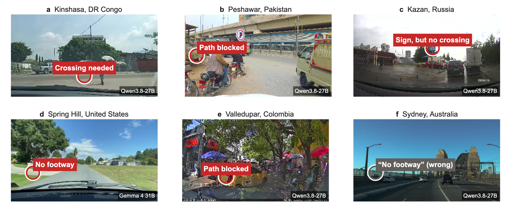
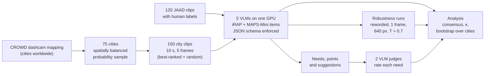
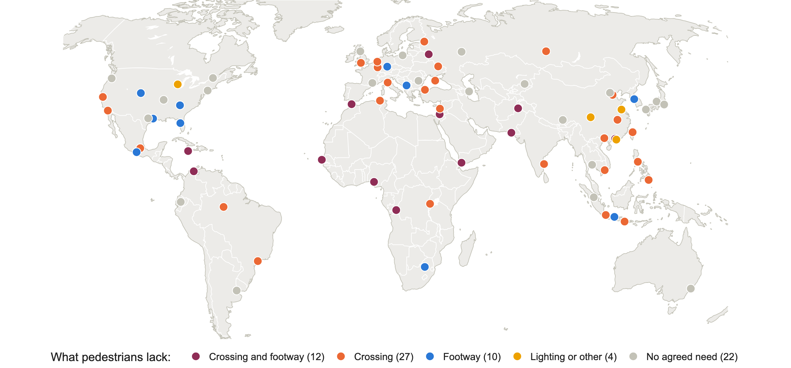
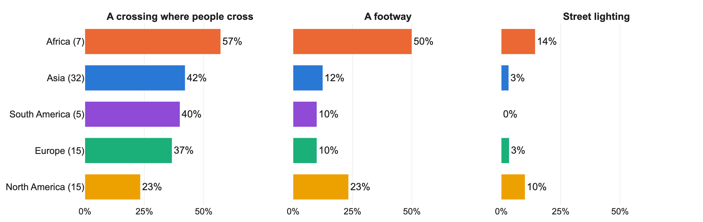
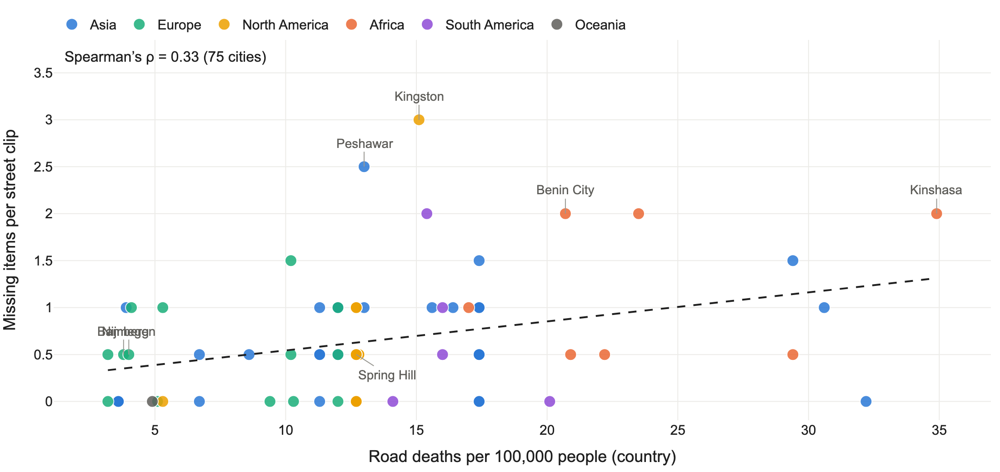
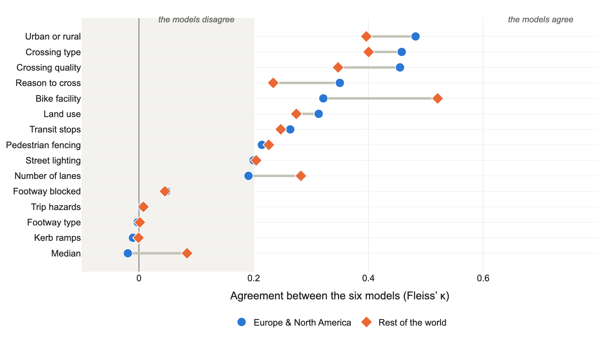
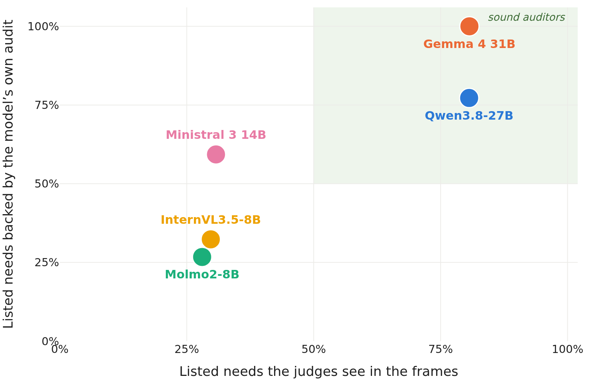

# What Pedestrians Lack Around the World

**Auditing street infrastructure in 75 cities with on-device vision-language models**

[](LICENSE)
[](https://www.python.org/)
[](https://docs.astral.sh/uv/)
[](#citation)

Code, model answers and analysis for the paper

> Md Shadab Alam, Alexandros Rouchitsas and Pavlo Bazilinskyy (2027).
> *What Pedestrians Lack Around the World: Auditing Street Infrastructure in 75 Cities with On-Device
> Vision-Language Models.* Human Interaction and Emerging Technologies (IHIET-AI 2027), Palma de Mallorca,
> Spain. Accepted for oral presentation.

Five open vision-language models (VLMs), run locally on one GPU, audit pedestrian infrastructure in dashcam
clips from 75 cities on six continents. They code each street with items from two established instruments,
the [iRAP](https://irap.org) road attributes and the MAPS-Mini streetscape audit, list what is missing, point
to it in the frame and suggest a change to the street. No footage leaves the machine.



**Figure 1.** Needs reported by the models on six continents, with the point each model gave (ring) on the
frame it named. Suggestions: (a) a marked crossing with a central refuge island; (b) remove the cart and
debris to clear the path; (c) a marked crossing with dropped kerbs at the sign; (d) a continuous sidewalk;
(e) a no-parking zone and relocating the stalls. (f) A false report: the bridge's footway is separated from
the roadway and not visible from the car. Three of five models made it, short of the 4-of-5 consensus.

## Contents

- [How it works](#how-it-works)
- [Main findings](#main-findings)
- [Data and materials](#data-and-materials)
- [Models](#models)
- [Reproducing the study](#reproducing-the-study)
- [Repository structure](#repository-structure)
- [Citation](#citation)
- [Licence](#licence)

## How it works



1. **Cities.** 75 cities in 43 countries are drawn from the CROWD mapping of dashcam videos to cities with the
   Local Pivotal Method, a spatially balanced probability sample, with inclusion probability proportional to
   the square root of population ([`scripts/data/sample_cities.py`](scripts/data/sample_cities.py)).
2. **Clips.** For each city, the video with the most daytime car footage is cut into 10 s windows. Windows are
   ranked with SigLIP2 image–text embeddings for pedestrian-relevant scenes, and one random window is added,
   so each city gives one best-ranked and one random clip ([`scripts/data/make_snippets.py`](scripts/data/make_snippets.py),
   [`scripts/data/build_clip_sets.py`](scripts/data/build_clip_sets.py)). 120 clips from the JAAD dataset, with human labels,
   check validity.
3. **Audit.** Each model sees five frames, 2 s apart, and codes the street as a road-safety auditor would code a
   100 m segment: road, each side's footway, and the crossing (iRAP and MAPS-Mini items). From the item answers,
   eight needs follow by fixed rules, and the model lists each one with evidence, a point on the frame, a standard
   measure and a one-sentence suggestion. vLLM enforces the JSON schema during decoding, so every answer
   holds every item ([`src/vlm_street_audit/vlm.py`](src/vlm_street_audit/vlm.py)).
4. **Robustness.** The audit is repeated with a reworded prompt, one frame instead of five, half the
   resolution (640 px) and twice at temperature 0.7 ([`scripts/audit/run_vlm.py`](scripts/audit/run_vlm.py)).
5. **Judges.** The two larger models rate every listed need: is the deficit visible, would the suggestion fix it,
   is it specific to the street, is it feasible, and does it tell people how to behave
   ([`scripts/audit/judge_suggestions.py`](scripts/audit/judge_suggestions.py)).
6. **Analysis.** An item counts for a clip when at least two thirds of the models agree (4 of 5). Cities are
   the unit, with 95% intervals from a bootstrap over cities ([`scripts/analysis/analyse_audit.py`](scripts/analysis/analyse_audit.py)).

An answer, abridged (Qwen3.8-27B on the Kinshasa clip of Figure 1a; the full file is
[`outputs/vlm/audit/cities/qwen3.8-27b/Q3WvZW9zBk8_00851000_010000.json`](outputs/vlm/audit/cities/qwen3.8-27b/Q3WvZW9zBk8_00851000_010000.json)):

```json
{
  "road": {"area_type": "urban", "land_use": "mixed", "number_of_lanes": "2", "street_lighting": "none", "...": "..."},
  "left_side": {"footway": "informal_path_1m_or_more", "obstruction": "partly_blocked", "trip_hazards": "some"},
  "crossing": {"crossing_demand": true, "crossing_facility": "none", "crossing_quality": "not_applicable",
               "kerb_ramps": "no_crossing"},
  "needed": [
    {"need": "no_crossing", "where": "road", "frame": 1, "x": 500, "y": 750,
     "evidence": "There is a high demand for crossing due to the market stalls and buildings, but no marked or purpose-built crossing is present.",
     "suggestion": "Install a marked pedestrian crossing with a central refuge island to provide a safe place for people to cross the road."},
    "..."
  ]
}
```

Points are integers from 0 to 1000 on the named frame, x from the left and y from the top.

## Main findings

**The crossing item is valid where it can be checked.** On JAAD's labelled clips, the iRAP crossing-facility
item finds marked crossings with a balanced accuracy of 0.86–0.92 for all five models.

**A crossing where people have reason to cross is the most common gap.** By consensus, street lighting is the most
common feature (82% of cities), a formal footway on both sides is found in 51%, and a crossing facility in only 21%.
In 39 of the 75 cities at least one clip needs a crossing, in 22 a footway, and in 12 both.



**Figure 2.** What pedestrians lack in each of the 75 cities: needs on which at least four of the five models agree
in at least one of the city's two clips.

**The gaps differ by continent.** A crossing is needed in 57% of African cities and 23% of North American ones. A
footway is needed in 50% of African and 23% of North American cities, against 10–12% in Europe and Asia: in Africa
basic provision is often absent, while many North American roads are built without footways.



**Figure 3.** Share of cities needing each of the three most common items, by continent (number of cities in
brackets). Oceania, with one city, is left out.

**Needs follow road deaths.** The number of needs per clip rises with the country's road deaths per 100,000
(Spearman's ρ = 0.34, 95% CI 0.11 to 0.52) and falls with median age (−0.41) and literacy (−0.46). These are
country-level figures that track national income, so they describe a pattern, not a cause.



**Figure 4.** Missing items per street clip (consensus of the five models, averaged over each city's two clips)
against the country's road deaths per 100,000 people. Each dot is a city; the dashed line is a least-squares fit.

**The models agree somewhat less outside Europe and North America, and not at all on footway type.** Agreement on
the crossing items and lighting is lower for clips from the rest of the world (reason to cross κ = 0.33 against 0.46;
the intervals overlap). Footway type (κ = 0.03), trip hazards and kerb ramps are not reliable in any region.



**Figure 5.** Agreement between the five models on each item (Fleiss' κ) for clips from Europe and North America (60)
and from the rest of the world (90). The shaded band marks agreement below 0.2.

**Only the two largest models are sound auditors.** The judges see 81% of the needs listed by Qwen3.8 and Gemma 4
in the frames, against 28–31% for the three smaller models, and Gemma 4's needs always follow from its own items.
Rewording the prompt or halving the resolution changes few answers (mean κ 0.73 and 0.74); one frame (0.57) and
resampling (0.55) change more.

<p align="center"></p>

**Figure 6.** The five models as auditors: share of their listed needs that the judges rated visible in the frames
(mean of two judges) against the share backed by the model's own item answers.

All tables (with 95% intervals) are in [`outputs/vlm/analysis_audit/tables.md`](outputs/vlm/analysis_audit/tables.md).
Further figures, each with an interactive HTML version, are in [`docs/figures/audit/`](docs/figures/audit/):

| Figure | Shows |
|---|---|
| [`jaad_validity`](docs/figures/audit/jaad_validity.png) | Scene facts and the crossing item against JAAD's labels, per model |
| [`present_by_continent`](docs/figures/audit/present_by_continent.png) | Infrastructure present, by continent |
| [`needed_by_continent`](docs/figures/audit/needed_by_continent.png) | Infrastructure needed, by continent |
| [`country_indicators`](docs/figures/audit/country_indicators.png) | Spearman's ρ with road deaths, median age, Gini and literacy |
| [`agreement_by_region`](docs/figures/audit/agreement_by_region.png) | Fleiss' κ per item and region, with intervals |
| [`robustness`](docs/figures/audit/robustness.png) | Cohen's κ under each changed condition |
| [`suggestion_quality`](docs/figures/audit/suggestion_quality.png) | Judges' ratings per auditor model |

## Data and materials

| What | Where |
|---|---|
| Video clips (150 city clips, 10 s each), their frames, and a snapshot of the code | [Dropbox folder](https://www.dropbox.com/scl/fo/cl1e4cgdjlj43i5gy4gsy/ALxGI5IgWYm9RRxrfey5AYA?rlkey=cu2udsf5ooey7cp2ff6efu4ut&st=zjngk7m6&dl=0) |
| Every model answer on the city clips: main audit and the four robustness runs (4,500 files) | [`outputs/vlm/<run>/cities/<model>/`](outputs/vlm/) |
| Every judge rating (1,206 rated answers, 1,874 needs rated by both judges) | [`outputs/vlm/judge/<judge>/<auditor>/`](outputs/vlm/judge/) |
| The tables behind every number, as CSV | [`outputs/vlm/analysis_audit/`](outputs/vlm/analysis_audit/) |
| The city sample and its design (inclusion probabilities, weights, diagnostics) | [`data/city_sample/`](data/city_sample/) |
| The sampling frame (CROWD mapping of videos to cities) | [`data/mapping_original.csv`](data/mapping_original.csv) |

Each answer file holds the model's checkpoint and revision, the prompt version (a hash of prompt and schema), the
condition (temperature, seed, frames, image size), the frame paths, the raw text and the parsed answer. A clip's
id is `<YouTube video id>_<start ms>_<length ms>`, so each clip can be traced to its source video. The footage itself
comes from YouTube via the CROWD dataset; this repository holds no video. JAAD's clips and labels come from
[the JAAD dataset](https://data.nvision2.eecs.yorku.ca/JAAD_dataset/); the answers on them are not included, but
their scores are in [`jaad_validity.csv`](outputs/vlm/analysis_audit/jaad_validity.csv).

## Models

All models run on one NVIDIA RTX 5090 (32 GB) with [vLLM](https://github.com/vllm-project/vllm) through its
OpenAI-compatible API on localhost, at temperature 0, each pinned to a checkpoint revision in
[`configs/models.toml`](configs/models.toml).

| Model | Developer (country) | Run as | Checkpoint |
|---|---|---|---|
| Qwen3.8-27B | Alibaba (China) | 4-bit, W4A16 | [RedHatAI/Qwen3.8-27B-INT4](https://huggingface.co/RedHatAI/Qwen3.8-27B-INT4) |
| Gemma 4 31B | Google (US) | 4-bit, quantisation-aware | [google/gemma-4-31B-it-qat-w4a16-ct](https://huggingface.co/google/gemma-4-31B-it-qat-w4a16-ct) |
| Molmo2-8B | Allen Institute for AI (US) | BF16 | [allenai/Molmo2-8B](https://huggingface.co/allenai/Molmo2-8B) |
| InternVL3.5-8B | Shanghai AI Laboratory (China) | BF16 | [OpenGVLab/InternVL3_5-8B-HF](https://huggingface.co/OpenGVLab/InternVL3_5-8B-HF) |
| Ministral 3 14B | Mistral AI (France) | FP8, the developer's release | [mistralai/Ministral-3-14B-Instruct-2512](https://huggingface.co/mistralai/Ministral-3-14B-Instruct-2512) |

Ministral runs with Mistral's own tokeniser and weight format, as Mistral documents it; with the Hugging Face
tokeniser its answers were valid JSON but nonsense. EXAONE 4.5 33B (LG AI Research, South Korea) was tried as a
sixth model and excluded: under vLLM 0.32 it answered text correctly but returned nonsense for every image.

## Reproducing the study

### Setup

The project uses [uv](https://docs.astral.sh/uv/) with Python 3.12; vLLM has its own environment in
[`serve/`](serve/).

```bash
uv sync
uv run pytest                  # tests, no network or GPU needed
cd serve && uv sync            # vLLM, on the GPU machine (Linux or WSL2, CUDA 12.8+ for Blackwell)
bash download_models.sh       # the weights at the pinned revisions (~160 GB)
```

[`serve/download_models.sh`](serve/download_models.sh) fetches exactly the checkpoints and revisions in [`configs/models.toml`](configs/models.toml)
(pass model keys to fetch only some) and builds the local tokeniser Kanana needs. Gated models need their terms
accepted on Hugging Face and `uv run --project serve hf auth login` first.

Settings are in [`default.config`](default.config); to change one locally, copy it to `config` and edit that (an
unknown setting is an error). Downloading CROWD footage needs a login to the CROWD file server: copy
`default.secret` to `secret` and fill it in (both `config` and `secret` are ignored by git).

### The analysis from the published answers

The published answers and ratings are enough to recompute every table and figure, without a GPU:

```bash
uv run python scripts/analysis/analyse_audit.py    # tables in outputs/vlm/analysis_audit/, figures in docs/figures/
uv run python scripts/analysis/paper_figures.py    # the paper's six figures in docs/figures/paper/ (Figure 1 needs the frames)
```

The JAAD validity table also needs JAAD's labels for the sampled clips (`data/clip_sets/jaad_labels.json`, built
by `scripts/data/build_clip_sets.py` from the JAAD annotations). Static PNGs need a Chromium browser for Kaleido; set
`BROWSER_PATH` if Chrome is not installed, or pass `--no-png` to `analyse_audit.py` for HTML only.

### The full pipeline

```bash
uv run python scripts/data/sample_cities.py                         # draw the 75 cities (seed 20260818, alpha 0.5)
uv run python scripts/data/fetch_data.py --videos-per-city 1        # fetch each city's video with the most footage
uv run python scripts/data/make_snippets.py --videos-per-city 1     # rank 10 s windows, cut clips and frames
uv run python scripts/data/build_clip_sets.py                       # city and JAAD clip sets
uv run python scripts/audit/run_vlm.py --start-server --models all --sets jaad cities          # main audit
uv run python scripts/audit/run_vlm.py --start-server --prompt audit_reworded --tag audit-reworded
uv run python scripts/audit/run_vlm.py --start-server --tag audit-1frame --frames 3
uv run python scripts/audit/run_vlm.py --start-server --tag audit-640px --max-side 640
uv run python scripts/audit/run_vlm.py --start-server --tag audit-t07-s1 --temperature 0.7 --seed 1 --sets cities
uv run python scripts/audit/run_vlm.py --start-server --tag audit-t07-s2 --temperature 0.7 --seed 2 --sets cities
uv run python scripts/audit/judge_suggestions.py --start-server       # Qwen3.8 and Gemma 4 rate every listed need
uv run python scripts/analysis/analyse_audit.py
uv run python scripts/analysis/paper_figures.py
```

`run_vlm.py --start-server` starts vLLM for each model in turn, answers every clip and stops it; answered clips
are skipped, so a stopped run resumes where it left off. On one RTX 5090, each model's share of the audit (1,380
answers) takes about half a day to a day.

<details>
<summary><b>How the cities are drawn</b></summary>

Cities are drawn from the CROWD mapping ([`data/mapping_original.csv`](data/mapping_original.csv), from
[opticarvis-global](https://github.com/Shaadalam9/opticarvis-global)) with the Local Pivotal Method
([lpm-sampling](https://github.com/M-Colley/lpm-sampling)), a spatially balanced probability sample, with inclusion
probability proportional to population^0.5 (at 75 cities, 0.5 nearly doubles the effective sample size against 0.75,
42 against 24, for about 8% sparser coverage).

- Eligibility comes first: at least 1 h of daytime car footage, valid coordinates and population. Filtering after the
  draw would break the probabilities.
- No one-city-per-country rule: large countries get several cities, small ones at most one.
- `1/pi` is each city's design weight, kept in `design_manifest.csv`.
- A drawn city with no usable footage would be reported as missing, never swapped for a neighbour (none was).

| File in `data/city_sample/` | Contents |
|---|---|
| `mapping.csv` | The drawn cities in mapping format, holding only the qualifying footage |
| `design_manifest.csv` | The drawn cities with `pi` and `design_weight` |
| `eligible_frame_with_pi.csv` | Every eligible city with its inclusion probability |
| `selected_cities_by_country.csv` | Cities drawn per country |
| `diagnostics.txt` | Spatial balance, nearest-city distance, effective sample size, weights |

</details>

<details>
<summary><b>How the clips are chosen</b></summary>

1. **Windows**: 10 s windows every 5 s inside each mapped daytime car segment.
2. **Semantic rank**: SigLIP2 (`google/siglip2-base-patch16-224`) embeds keyframes at least 2 s apart. Each window
   is scored by how much the prompt groups in [`configs/snippet_prompts.json`](configs/snippet_prompts.json)
   (footway condition, obstruction, crossings, pedestrian exposure, accessibility, vulnerable users) beat the best
   routine-scene prompt (motorway, countryside, tunnel, tidy street) on the same keyframes.
3. **Tie break**: packet energy, the encoded bytes per second from ffprobe.
4. **One window per event**: the best window claims its neighbours within 30 s.
5. **Per video**: the best-ranked events plus one random window. The random windows are not chosen for problems,
   so they show what an ordinary stretch looks like and keep prevalence estimates honest.

Each snippet is written as an H.264 clip and JPEG frames, with every snippet's scores in `data/snippets/snippets.csv`.
Downloaded videos are deleted once cut (`--keep-downloads` keeps them). All numbers are settings in
`default.config` (`snippet_*`, `semantic_*`).

</details>

## Repository structure

```
configs/
  models.toml              the VLMs: checkpoints, revisions, serving settings
  snippet_prompts.json     prompts that rank the 10 s windows
data/
  mapping_original.csv     the sampling frame (CROWD mapping)
  city_sample/             the drawn cities and their design files
docs/figures/
  paper/                   the paper's six figures (PNG and interactive HTML)
  audit/                   the further analysis figures
outputs/vlm/
  audit*/<set>/<model>/    the model answers (main run and robustness runs; JAAD and city clips)
  judge/<judge>/<auditor>/ the judges' ratings
  analysis_audit/          every table, as CSV and Markdown
scripts/
  data/                    sample_cities, plot_city_sample, fetch_data, make_snippets, build_clip_sets
  audit/                   run_vlm (the audit), judge_suggestions (the judges)
  analysis/                analyse_audit (tables and figures), paper_figures
serve/                     vLLM environment (run on the GPU machine): serve.py starts one model,
                           download_models.sh fetches the pinned weights, prepare_tokenizers.py
src/vlm_street_audit/      prompt and schema (vlm), vLLM start and stop (server), statistics (evaluation),
                           snippets, semantics, JAAD labels, CROWD file server, configuration, figure style
tests/                     pytest, no network or GPU
```

Downloaded videos, snippets, frames and logs stay out of git. Code and text follow [AGENTS.md](AGENTS.md):
British English, Plotly for every figure, uv for every package operation, on-device models only.

## Citation

If you use this code or data, please cite the paper:

```bibtex
@inproceedings{alam2027pedestrians,
  author    = {Alam, Md Shadab and Rouchitsas, Alexandros and Bazilinskyy, Pavlo},
  title     = {What Pedestrians Lack Around the World: Auditing Street Infrastructure in 75 Cities
               with On-Device Vision-Language Models},
  booktitle = {Human Interaction and Emerging Technologies (IHIET-AI 2027): Artificial Intelligence
               and Future Applications},
  address   = {Palma de Mallorca, Spain},
  publisher = {AHFE International},
  year      = {2027},
  note      = {Accepted for publication}
}
```

Citation metadata is also in [`CITATION.cff`](CITATION.cff).

## Licence

The code is released under the MIT licence, see [LICENSE](LICENSE). The model answers and ratings are released under
the same terms. The video footage belongs to its creators on YouTube and is not redistributed here. Security reports:
see [SECURITY.md](SECURITY.md).

Contact: Md Shadab Alam, Eindhoven University of Technology, [m.s.alam@tue.nl](mailto:m.s.alam@tue.nl).
