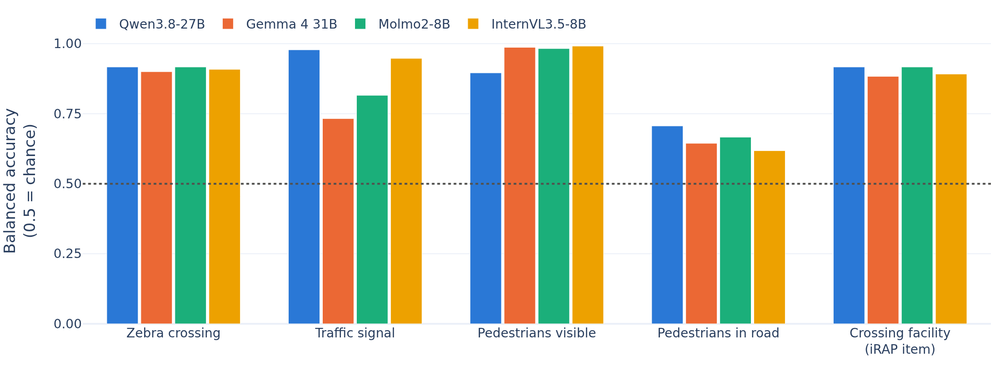
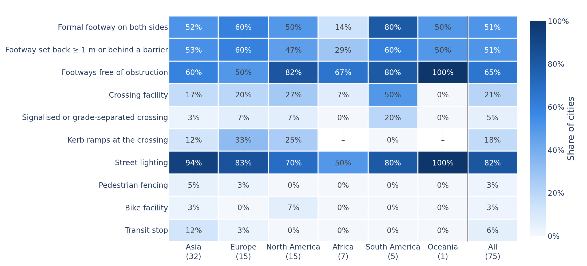
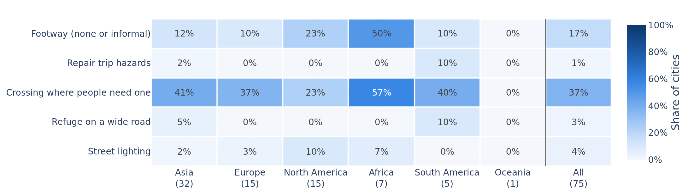
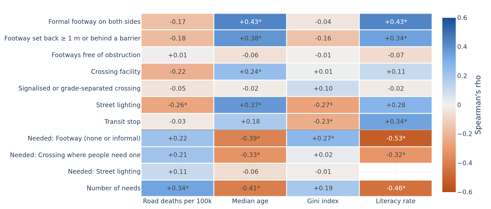
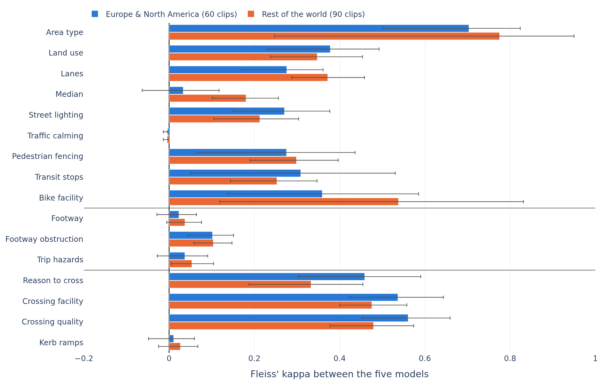
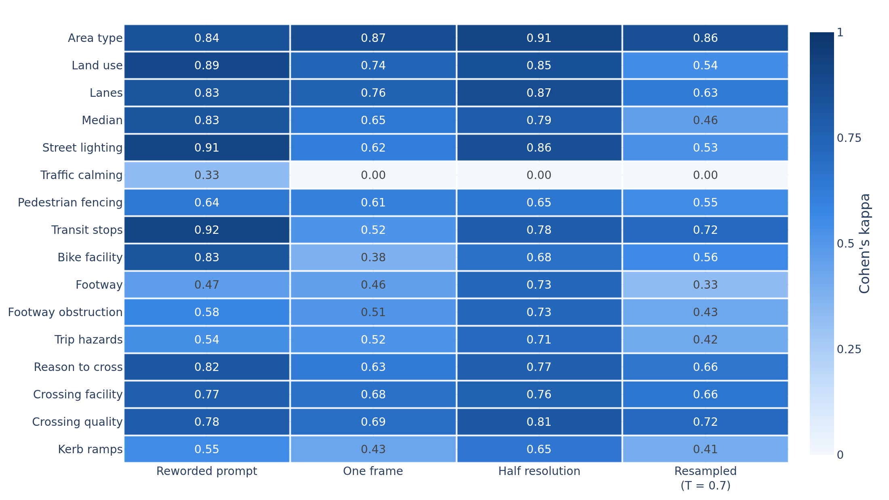
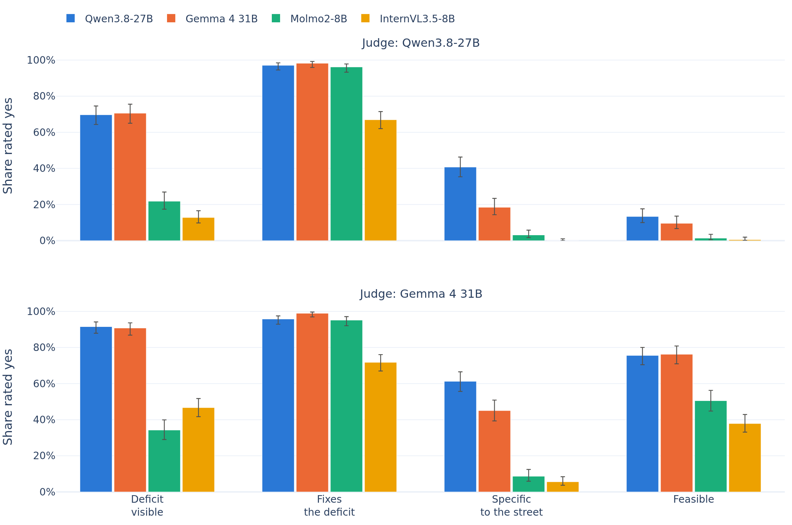

# VLM Street Audit

Using vision-language models (VLMs) to analyse real-world street footage, identify
pedestrian-related problems, localise them in the scene, and suggest street improvements.

## Background

The original concept was a browser-based interface in which people pause street footage,
mark a location in the frame, and describe an observed pedestrian issue and a possible
intervention. The project has since moved away from human participants: the task is now
carried out entirely by VLMs/LLMs.

## Goal

Given street footage, a VLM should:

1. **Detect** pedestrian or infrastructure issues (e.g. missing or blocked pavements,
   unsafe crossings, poor visibility, conflicts with vehicles).
2. **Localise** each issue in the frame (timestamp + bounding box or point).
3. **Describe** the issue in plain language.
4. **Suggest** a concrete improvement or intervention.

## On-device models only

All model inference runs locally (e.g. Hugging Face `transformers` or Ollama).
No cloud APIs: footage and frames never leave the machine.

### Models (RTX 5090, 32 GB)

Several VLMs from different developers do the same task on the same frames, one
model at a time. Details and checkpoints in [`configs/models.toml`](configs/models.toml).

| Model | Developer | Run as | Weights | Why it is in the set |
|---|---|---|---|---|
| Qwen3.8-27B | Alibaba | 4-bit (W4A16) | ~17 GB | Newest and strongest general model; images and video |
| Gemma 4 31B | Google | 4-bit (Google's QAT) | ~19 GB | Second large model from another lineage; detection and pointing |
| Molmo2-8B | Ai2 | BF16 | ~18 GB | Localisation specialist (points, video tracks); open training data |
| InternVL3.5-8B | Shanghai AI Lab | BF16 | ~17 GB | Fourth lineage; an older baseline |

- 27-31B models do not fit 32 GB in BF16 (~55-62 GB), so they run as 4-bit checkpoints.
- Served with vLLM (Linux/WSL2, CUDA 12.8+ for Blackwell) on localhost through its
  OpenAI-compatible API, so one client works for every model. Ollama works too, but its
  GGUF quantisations and image resizing differ per model, which makes coordinates harder
  to compare.
- Fixed per run: frames, prompt, image resolution, temperature 0, and each model's
  checkpoint revision.

## Research questions

- Which pedestrian infrastructure is present on ordinary streets around the world, and which is missing?
- How does that differ between continents, and does it follow country indicators (road deaths, median age, inequality, literacy)?
- Do the models audit streets outside Europe and North America as reliably as inside (model bias by region)?
- How robust are the answers to rewording, fewer frames, lower resolution and resampling?
- Are the suggested improvements real, specific and feasible, as rated by VLM judges?

## Results (28 October – 3 November 2026)

**Method.** Each model audits a clip (5 frames over 10 s) with items from two established instruments:

- **iRAP road attributes** (Star Rating Coding Manual, drive-on-left edition 3.2): pedestrian crossing facility
  (grade separated, signalised or marked, with or without a refuge, raised, refuge only, none) and its quality,
  footway provision per side (physical barrier, ≥ 3 m, 1–3 m, < 1 m, informal path, none), pedestrian fencing,
  number of lanes, median. iRAP codes 100 m segments, about what a 10 s clip covers.
- **MAPS-Mini** (Sallis et al. 2015, *Preventing Chronic Disease* 12:150098): street lighting, traffic calming,
  kerb ramps, footway obstructions and trip hazards, transit stops, bike facilities, land use.

From the item answers, eight needs follow by fixed rules (e.g. no or informal footway on a side → *footway needed*;
people have a reason to cross and there is no facility → *crossing needed*; 4+ lanes with an at-grade crossing and no
refuge → *refuge needed*). The model also lists each need itself, with evidence, a measure and a suggested change.
Prompt and schema are in `src/vlm_street_audit/vlm.py`; answers are constrained to the JSON schema by vLLM.

**Data.** 5,520 valid answers, none missing:

| Run | Clips | Answers |
|---|---|---|
| Main audit (temperature 0) | 120 JAAD + 150 city clips (2 per city, 75 cities) | 1,080 |
| Reworded prompt | same | 1,080 |
| One frame (the middle one) | same | 1,080 |
| Half resolution (640 px) | same | 1,080 |
| Two samples at temperature 0.7 | 150 city clips | 2 × 600 |

Two judges (Qwen3.8 and Gemma 4) then rated each listed need and suggestion of the main run's 464 city answers that
list any: 1,253 needs, each rated by both. All numbers come from `scripts/analyse_audit.py`; its tables and CSVs are
in `outputs/vlm/analysis_audit/`. *Consensus* means at least 3 of the 4 models agree; cities are the unit, each
city's two clips averaged, with 95% intervals from a bootstrap over cities (seed 20261028).

**Published data.** Every answer on the city clips and every judge rating is in this repository (text only, no
frames), so each number can be checked:

| Folder | Contents |
|---|---|
| `outputs/vlm/<run>/cities/<model>/<clip_id>.json` | 3,600 answers: runs `audit`, `audit-reworded`, `audit-1frame`, `audit-640px`, `audit-t07-s1`, `audit-t07-s2`. Each holds the model's checkpoint and revision, the prompt version, the condition (temperature, seed, frames, image size), the frame paths, the raw text and the parsed answer, with its `needed` list (need, evidence, frame, point, measure, suggestion) |
| `outputs/vlm/judge/<judge>/<auditor>/<clip_id>.json` | 928 rated answers: the needs as listed and one rating per need |
| `outputs/vlm/analysis_audit/` | The CSV tables behind every number above, and `tables.md` |

A clip's frames can be rebuilt from its id (`<video_id>_<start ms>_<length ms>`) with the CROWD videos and
`scripts/make_snippets.py`. The answers on the JAAD clips are not included; their scores are in
`outputs/vlm/analysis_audit/jaad_validity.csv`.

### Main findings

1. **The crossing item is valid where it can be checked.** On JAAD's labelled clips the iRAP crossing-facility item
   finds marked crossings with a balanced accuracy of 0.88–0.92 for all four models. *Pedestrians in the road*
   remains the weakest scene fact (0.62–0.71).
2. **What is there.** Street lighting is the most common feature (83% of cities by consensus), then a footway set
   back at least 1 m (51%) and a formal footway on both sides (43%). A crossing facility is in view in 24% of
   cities and a signalised one in 11%; refuge islands and traffic calming are never agreed on.
3. **What is missing differs by continent.**
   - A **crossing where people have reason to cross** is the most common need: 42% of cities, 64% in Africa,
     47% in Asia, 40% in Europe and 27% in North America.
   - A **footway** (none or only an informal path) is needed in 50% of African cities and 30% of North American
     ones, against 10–12% in Europe and Asia. North America's share comes from roads built without footways,
     not from poor ones.
   - **Street lighting** is missing mostly in Africa (21%) and North America (17%).
   - African cities have the fewest formal footways on both sides (7% against 42–57%) and crossings (7%).
     Africa has 7 cities, South America 5 and Oceania 1, so their intervals are wide.
4. **Needs follow country indicators.** Over the 75 cities, the number of needs rises with road deaths per
   100,000 (Spearman's rho 0.41, 0.21 to 0.58) and falls with median age (−0.43) and literacy (−0.54, 51 cities
   with data). Formal footways on both sides rise with median age (0.42) and literacy (0.50). Inequality (Gini)
   shows little, except more cities needing footways where it is higher (0.28). These are country-level figures
   and correlate with national income, so they describe a pattern, not a cause.
5. **Model bias by region: agreement is lower outside Europe and North America for crossings and lighting.**
   - The four models agree on the crossing items less in the rest of the world than in Europe and North America:
     crossing quality kappa 0.59 against 0.73, crossing facility 0.47 against 0.61, reason to cross 0.25 against
     0.42, street lighting 0.26 against 0.45. The intervals overlap for each item, but the direction is the same
     for all four.
   - Qwen3.8 lists needs that match its own item answers in 57% of answers in Europe and North America but in 33%
     elsewhere; Gemma 4 is consistent in 90% of answers in both.
   - The footway items have kappa near 0 in both regions: the models do not agree on a side's footway type, so the
     footway results above rest on the clips where at least 3 of 4 happen to agree. Kerb ramps (−0.04) and traffic
     calming are not usable.
6. **Robust to wording and resolution, less to fewer frames and resampling.** Against the main answers, mean
   Cohen's kappa over items and models is 0.73 for a reworded prompt and 0.75 at half resolution, but 0.58 with one
   frame instead of five, and two samples at temperature 0.7 agree with each other at only 0.55. The footway item
   is the least stable (0.33 between samples). Robustness is about the same in both regions.
7. **The large models' suggestions hold up; the small models' do not.**
   - Both judges rate most needs listed by Qwen3.8 and Gemma 4 as visible in the frames (70–92%), but most of
     Molmo2's and InternVL3.5's as not (13–47%).
   - Almost every suggestion would fix its stated deficit (both judges, 67–99%; judge agreement kappa 0.77).
     Suggestions are seldom specific to the street (0–61%), and none tells people to behave differently.
   - The judges disagree on feasibility (kappa 0.07): Gemma rates 76% of the large models' suggestions feasible,
     Qwen 10–13%. Gemma is more lenient on every auditor by a similar margin, including Qwen's own suggestions,
     so there is no clear sign that a judge favours its own model.
   - Judged quality is about the same for both regions (deficit visible 51% against 54%).

**Earlier runs (27–28 October).** An open prompt ("list up to five problems") made the models collapse onto one
problem type and ignore streets without people; a six-type checklist fixed that but gave no basis for comparing
countries, which is why the audit uses iRAP and MAPS-Mini items. Only Qwen3.8 localised problems reliably
(83% of its points on a labelled pedestrian in JAAD); Molmo2 and InternVL3.5 mostly returned placeholder points.
Those results are in commit e3020d3.

**Limits.**
- There is no human ground truth for the city clips; agreement between models is not correctness, and the
  footway items are not reliable.
- JAAD is North American and European footage, so validity outside those regions is not checked.
- Two clips per city, from YouTube driving videos: the figures describe the streets those videos cover, not a
  city's streets as a whole.
- Country indicators are national, and literacy is missing for 24 cities.

### Figures

Each figure links to its Plotly HTML in `docs/figures/`; download it and open it in a browser for the
interactive version (GitHub shows HTML files as source).

[](docs/figures/audit_jaad_validity.html)

**Figure 1.** Scene facts and the iRAP crossing-facility item against JAAD's labels (120 clips): balanced
accuracy per model, where 0.5 (dotted line) is chance.

[](docs/figures/audit_present_by_continent.html)

**Figure 2.** Share of cities where at least 3 of the 4 models agree a feature is present, by continent (number of
cities in brackets). Refuge islands and traffic calming are at 0% everywhere and only in the table.

[](docs/figures/audit_needed_by_continent.html)

**Figure 3.** Share of cities with each need, by continent. Needs that no city has (blocked footway, better
crossing, kerb ramps) are only in the table.

[](docs/figures/audit_country_indicators.html)

**Figure 4.** Spearman's rho between what cities have or need and their country's indicators (73–75 cities; 51
for literacy). An asterisk marks a 95% bootstrap interval that excludes 0; blank cells have too few cities with
or without the feature.

[](docs/figures/audit_agreement_by_region.html)

**Figure 5.** Agreement between the four models (Fleiss' kappa) on each item, for clips from Europe and North
America and from the rest of the world, with 95% bootstrap intervals over clips. Road items above the first line,
footway items (per side) between the lines, crossing items below.

[](docs/figures/audit_robustness.html)

**Figure 6.** Cohen's kappa between the main answers and each changed condition, mean of the four models (city
clips); "Resampled" compares two temperature-0.7 samples with each other. Traffic calming is almost never
reported, so its kappa is 0.

[](docs/figures/audit_suggestion_quality.html)

**Figure 7.** Share of each auditor model's listed needs and suggestions rated yes, by each judge, with 95% Wilson
intervals. No suggestion was rated as about behaviour, so that criterion is only in the table.

### Tables

120 JAAD clips and 150 city clips (75 cities) answered by all four models.

#### JAAD: balanced accuracy against the labels

| Item | Qwen3.8-27B | Gemma 4 31B | Molmo2-8B | InternVL3.5-8B |
|---|---|---|---|---|
| Zebra crossing | 0.92 | 0.90 | 0.92 | 0.91 |
| Traffic signal | 0.98 | 0.73 | 0.82 | 0.95 |
| Pedestrians visible | 0.90 | 0.99 | 0.98 | 0.99 |
| Pedestrians in road | 0.71 | 0.64 | 0.67 | 0.62 |
| Crossing facility (iRAP item) | 0.92 | 0.88 | 0.92 | 0.89 |

The crossing-facility item counts a marked, signalised or raised crossing and is scored against JAAD's crossing label.


#### Infrastructure present, by continent (share of cities; at least 3 of 4 models agree)

|  | Asia (32) | Europe (15) | North America (15) | Africa (7) | South America (5) | Oceania (1) | All (75) |
|---|---|---|---|---|---|---|---|
| Formal footway on both sides | 42% (27%–58%) | 57% (40%–73%) | 43% (23%–63%) | 7% (0%–21%) | 50% (20%–80%) | 50% | 43% (33%–51%) |
| Footway set back ≥ 1 m or behind a barrier | 52% (36%–67%) | 60% (40%–80%) | 47% (27%–67%) | 29% (7%–43%) | 60% (30%–90%) | 50% | 51% (41%–59%) |
| Footways free of obstruction | 54% (37%–72%) | 42% (19%–65%) | 62% (38%–85%) | 62% (25%–100%) | 80% (60%–100%) | 100% | 57% (46%–67%) |
| Crossing facility | 22% (12%–33%) | 20% (7%–33%) | 30% (10%–53%) | 7% (0%–21%) | 50% (20%–80%) | 50% | 24% (17%–31%) |
| Signalised or grade-separated crossing | 9% (3%–17%) | 7% (0%–17%) | 17% (3%–33%) | 0% (0%–0%) | 20% (0%–40%) | 50% | 11% (6%–15%) |
| Refuge island | 0% (0%–0%) | 0% (0%–0%) | 0% (0%–0%) | 0% (0%–0%) | 0% (0%–0%) | 0% | 0% (0%–0%) |
| Kerb ramps at the crossing | 0% (0%–0%) | 33% (0%–100%) | 0% (0%–0%) | – | 0% (0%–0%) | – | 7% (0%–21%) |
| Street lighting | 94% (88%–98%) | 83% (67%–97%) | 70% (50%–87%) | 57% (36%–79%) | 80% (40%–100%) | 100% | 83% (75%–89%) |
| Traffic calming | 0% (0%–0%) | 0% (0%–0%) | 0% (0%–0%) | 0% (0%–0%) | 0% (0%–0%) | 0% | 0% (0%–0%) |
| Pedestrian fencing | 8% (2%–16%) | 3% (0%–10%) | 0% (0%–0%) | 0% (0%–0%) | 0% (0%–0%) | 0% | 4% (1%–8%) |
| Bike facility | 3% (0%–8%) | 0% (0%–0%) | 10% (0%–20%) | 0% (0%–0%) | 0% (0%–0%) | 0% | 3% (1%–7%) |
| Transit stop | 12% (5%–20%) | 3% (0%–10%) | 3% (0%–10%) | 0% (0%–0%) | 0% (0%–0%) | 0% | 7% (3%–11%) |

#### Infrastructure needed, by continent (share of cities)

|  | Asia (32) | Europe (15) | North America (15) | Africa (7) | South America (5) | Oceania (1) | All (75) |
|---|---|---|---|---|---|---|---|
| Footway (none or informal) | 12% (5%–22%) | 10% (0%–20%) | 30% (17%–47%) | 50% (21%–79%) | 20% (0%–40%) | 50% | 20% (14%–27%) |
| Clear a blocked footway | 0% (0%–0%) | 0% (0%–0%) | 0% (0%–0%) | 0% (0%–0%) | 0% (0%–0%) | 0% | 0% (0%–0%) |
| Repair trip hazards | 5% (0%–12%) | 0% (0%–0%) | 0% (0%–0%) | 0% (0%–0%) | 10% (0%–30%) | 0% | 3% (0%–6%) |
| Crossing where people need one | 47% (33%–59%) | 40% (20%–63%) | 27% (7%–47%) | 64% (36%–93%) | 40% (10%–70%) | 0% | 42% (33%–51%) |
| Better crossing | 0% (0%–0%) | 0% (0%–0%) | 0% (0%–0%) | 0% (0%–0%) | 0% (0%–0%) | 0% | 0% (0%–0%) |
| Refuge on a wide road | 5% (0%–9%) | 0% (0%–0%) | 0% (0%–0%) | 0% (0%–0%) | 10% (0%–30%) | 0% | 3% (1%–5%) |
| Kerb ramps | 0% (0%–0%) | 0% (0%–0%) | 0% (0%–0%) | 0% (0%–0%) | 0% (0%–0%) | 0% | 0% (0%–0%) |
| Street lighting | 3% (0%–8%) | 7% (0%–17%) | 17% (3%–33%) | 21% (0%–50%) | 0% (0%–0%) | 0% | 8% (3%–13%) |

Cities are the unit: each city's two clips are averaged, and intervals come from a bootstrap over cities. Oceania is one city.


#### Infrastructure and country indicators (Spearman's rho over cities, 95% bootstrap interval)

|  | Road deaths per 100k (n = 73) | Median age (n = 75) | Gini index (n = 74) | Literacy rate (n = 51) |
|---|---|---|---|---|
| Formal footway on both sides | -0.25 (-0.46 to -0.03) | 0.42 (0.19 to 0.61) | -0.13 (-0.34 to 0.09) | 0.50 (0.28 to 0.67) |
| Footway set back ≥ 1 m or behind a barrier | -0.20 (-0.42 to 0.04) | 0.37 (0.15 to 0.57) | -0.16 (-0.37 to 0.07) | 0.33 (0.08 to 0.55) |
| Footways free of obstruction | 0.03 (-0.23 to 0.28) | 0.01 (-0.27 to 0.30) | 0.01 (-0.25 to 0.26) | -0.03 (-0.37 to 0.30) |
| Crossing facility | -0.21 (-0.42 to 0.02) | 0.28 (0.07 to 0.48) | -0.01 (-0.23 to 0.23) | 0.19 (-0.06 to 0.43) |
| Signalised or grade-separated crossing | -0.02 (-0.24 to 0.20) | 0.04 (-0.15 to 0.23) | 0.09 (-0.14 to 0.31) | 0.18 (-0.08 to 0.41) |
| Street lighting | -0.24 (-0.43 to -0.03) | 0.35 (0.14 to 0.53) | -0.26 (-0.46 to -0.02) | 0.23 (-0.07 to 0.48) |
| Pedestrian fencing | 0.12 (-0.07 to 0.29) | 0.07 (-0.15 to 0.25) | -0.00 (-0.14 to 0.12) | 0.23 (0.06 to 0.41) |
| Bike facility | 0.11 (-0.03 to 0.26) | 0.06 (-0.05 to 0.17) | 0.17 (0.02 to 0.31) | – |
| Transit stop | -0.07 (-0.32 to 0.19) | 0.23 (0.04 to 0.39) | -0.27 (-0.44 to -0.09) | 0.34 (0.13 to 0.51) |
| Needed: Footway (none or informal) | 0.18 (-0.05 to 0.40) | -0.37 (-0.57 to -0.15) | 0.28 (0.06 to 0.48) | -0.55 (-0.73 to -0.30) |
| Needed: Crossing where people need one | 0.28 (0.06 to 0.48) | -0.30 (-0.50 to -0.09) | -0.05 (-0.29 to 0.19) | -0.36 (-0.58 to -0.10) |
| Needed: Street lighting | 0.19 (-0.01 to 0.36) | -0.24 (-0.43 to -0.02) | 0.14 (-0.09 to 0.35) | -0.25 (-0.49 to 0.06) |
| Number of needs | 0.41 (0.21 to 0.58) | -0.43 (-0.61 to -0.20) | 0.17 (-0.08 to 0.40) | -0.54 (-0.72 to -0.29) |

Country figures from the city sample (CROWD mapping); a positive rho means the item is more common where the indicator is higher.


#### Agreement between the four models, by region (Fleiss' kappa, city clips, 95% interval)

| Item | All clips | Europe & North America (60 clips) | Rest of the world (90 clips) |
|---|---|---|---|
| Area type | 0.68 | 0.64 (0.42 to 0.78) | 0.73 (0.12 to 0.94) |
| Land use | 0.42 | 0.42 (0.28 to 0.54) | 0.40 (0.29 to 0.51) |
| Lanes | 0.33 | 0.26 (0.14 to 0.37) | 0.31 (0.21 to 0.41) |
| Median | 0.12 | 0.01 (-0.09 to 0.08) | 0.18 (0.09 to 0.25) |
| Street lighting | 0.35 | 0.45 (0.28 to 0.59) | 0.26 (0.13 to 0.39) |
| Traffic calming | -0.00 | -0.00 (-0.02 to -0.00) | – |
| Pedestrian fencing | 0.23 | 0.22 (0.04 to 0.37) | 0.22 (0.10 to 0.32) |
| Transit stops | 0.46 | 0.53 (-0.01 to 0.83) | 0.43 (0.26 to 0.57) |
| Bike facility | 0.48 | 0.42 (0.23 to 0.64) | 0.55 (0.16 to 0.83) |
| Footway (per side) | 0.02 | 0.01 (-0.05 to 0.05) | 0.02 (-0.02 to 0.07) |
| Footway obstruction (per side) | 0.11 | 0.09 (0.03 to 0.13) | 0.12 (0.07 to 0.17) |
| Trip hazards (per side) | 0.05 | 0.04 (-0.03 to 0.10) | 0.05 (-0.01 to 0.10) |
| Reason to cross | 0.34 | 0.42 (0.25 to 0.57) | 0.25 (0.08 to 0.39) |
| Crossing facility | 0.53 | 0.61 (0.49 to 0.73) | 0.47 (0.39 to 0.56) |
| Crossing quality | 0.65 | 0.73 (0.60 to 0.85) | 0.59 (0.47 to 0.70) |
| Kerb ramps | -0.04 | -0.04 (-0.12 to 0.02) | -0.04 (-0.09 to 0.00) |

#### Listed needs against the item answers, by region

| Model | Region | Needs per clip | Item needs listed | Listed needs backed by an item | Answers fully consistent |
|---|---|---|---|---|---|
| Qwen3.8-27B | Europe & North America | 1.4 | 86% | 80% | 57% |
| Qwen3.8-27B | Rest of the world | 1.6 | 83% | 75% | 33% |
| Gemma 4 31B | Europe & North America | 1.4 | 94% | 100% | 90% |
| Gemma 4 31B | Rest of the world | 1.8 | 95% | 100% | 90% |
| Molmo2-8B | Europe & North America | 0.6 | 67% | 24% | 43% |
| Molmo2-8B | Rest of the world | 0.6 | 88% | 28% | 52% |
| InternVL3.5-8B | Europe & North America | 1.2 | 40% | 25% | 15% |
| InternVL3.5-8B | Rest of the world | 1.5 | 53% | 37% | 21% |

#### Robustness: Cohen's kappa with the main answers (city clips, mean of the four models)

| Item | Reworded prompt | One frame | Half resolution | Resampled (T = 0.7) |
|---|---|---|---|---|
| Area type | 0.84 | 0.87 | 0.91 | 0.86 |
| Land use | 0.89 | 0.74 | 0.85 | 0.54 |
| Lanes | 0.83 | 0.76 | 0.87 | 0.63 |
| Median | 0.83 | 0.65 | 0.79 | 0.46 |
| Street lighting | 0.91 | 0.62 | 0.86 | 0.53 |
| Traffic calming | 0.33 | 0.00 | 0.00 | 0.00 |
| Pedestrian fencing | 0.64 | 0.61 | 0.65 | 0.55 |
| Transit stops | 0.92 | 0.52 | 0.78 | 0.72 |
| Bike facility | 0.83 | 0.38 | 0.68 | 0.56 |
| Footway | 0.47 | 0.46 | 0.73 | 0.33 |
| Footway obstruction | 0.58 | 0.51 | 0.73 | 0.43 |
| Trip hazards | 0.54 | 0.52 | 0.71 | 0.42 |
| Reason to cross | 0.82 | 0.63 | 0.77 | 0.66 |
| Crossing facility | 0.77 | 0.68 | 0.76 | 0.66 |
| Crossing quality | 0.78 | 0.69 | 0.81 | 0.72 |
| Kerb ramps | 0.55 | 0.43 | 0.65 | 0.41 |

#### Robustness by region (mean Cohen's kappa over items and models, city clips)

| Change | Europe & North America | Rest of the world |
|---|---|---|
| Reworded prompt | 0.75 | 0.73 |
| One frame | 0.61 | 0.57 |
| Half resolution | 0.75 | 0.77 |
| Resampled (T = 0.7) | 0.57 | 0.54 |

"Resampled" compares two runs at temperature 0.7 with each other, not with the main run.


#### Suggestions: share rated yes by each judge (city clips)


##### Judge: Qwen3.8-27B

| Criterion | Qwen3.8-27B (n = 307) | Gemma 4 31B (n = 282) | Molmo2-8B (n = 289) | InternVL3.5-8B (n = 375) |
|---|---|---|---|---|
| Deficit visible | 70% | 71% | 22% | 13% |
| Fixes the deficit | 97% | 98% | 96% | 67% |
| Specific to the street | 41% | 18% | 3% | 0% |
| Feasible | 13% | 10% | 1% | 1% |
| About behaviour | 0% | 0% | 0% | 0% |

##### Judge: Gemma 4 31B

| Criterion | Qwen3.8-27B (n = 307) | Gemma 4 31B (n = 282) | Molmo2-8B (n = 289) | InternVL3.5-8B (n = 375) |
|---|---|---|---|---|
| Deficit visible | 92% | 91% | 34% | 47% |
| Fixes the deficit | 96% | 99% | 95% | 72% |
| Specific to the street | 61% | 45% | 9% | 6% |
| Feasible | 76% | 76% | 51% | 38% |
| About behaviour | 0% | 0% | 0% | 0% |

##### Judged quality by region (both judges, all auditors)

| Criterion | Europe & North America (n = 896) | Rest of the world (n = 1610) |
|---|---|---|
| Deficit visible | 51% | 54% |
| Fixes the deficit | 85% | 90% |
| Specific to the street | 19% | 24% |
| Feasible | 32% | 32% |
| About behaviour | 0% | 0% |

##### Agreement between the judges (1253 suggestions rated by both)

| Criterion | Same rating | Cohen's kappa |
|---|---|---|
| Deficit visible | 71% | 0.44 |
| Fixes the deficit | 95% | 0.77 |
| Specific to the street | 80% | 0.42 |
| Feasible | 47% | 0.07 |
| About behaviour | 100% | – |

##### Self-preference: a judge's yes-share minus the other judge's, in points

| Judge | Criterion | On its own model | On the two neutral models |
|---|---|---|---|
| Qwen3.8-27B | Deficit visible | -22 | -23 |
| Qwen3.8-27B | Fixes the deficit | +1 | -2 |
| Qwen3.8-27B | Specific to the street | -21 | -6 |
| Qwen3.8-27B | Feasible | -62 | -43 |
| Qwen3.8-27B | About behaviour | +0 | +0 |
| Gemma 4 31B | Deficit visible | +20 | +23 |
| Gemma 4 31B | Fixes the deficit | +1 | +2 |
| Gemma 4 31B | Specific to the street | +27 | +6 |
| Gemma 4 31B | Feasible | +67 | +43 |
| Gemma 4 31B | About behaviour | +0 | +0 |

## Setup

The project uses [uv](https://docs.astral.sh/uv/) (Python 3.12):

```bash
uv sync
cp default.secret secret      # then fill in the file-server login (never commit it)
uv run pytest                 # tests, no network needed
```

Settings live in `default.config`; to change one locally, copy it to `config` and edit
that (an unknown setting there is an error). Code and text follow [AGENTS.md](AGENTS.md):
British English, Plotly for every figure, uv for every package operation.

## Getting the footage

Videos and CROWD's YOLO track CSVs come from the CROWD file server
(`files.mobility-squad.com`). It is an authenticated HTTP server, though its login is
stored as `ftp_username` / `ftp_password` in `secret`, as in the other CROWD projects.
`vlm_street_audit.file_server.FileServer` looks in this order:

1. the local drives (`video_dirs`, `bbox_dirs`; they exist on lin4080),
2. the download folders (`data/videos/`, `data/bbox/`),
3. the server: the file's URL under each alias (`tue4`, `tue5`, `tue3`, `tue2`, `tue1` for
   videos, `data` for track files), then a walk of the server's folder pages.

Downloads are written to a `.part` file and renamed only when complete.

The 75 cities hold about 5,500 videos, so fetch a selection: the videos with the most
qualifying footage per city.

```bash
uv run python scripts/fetch_data.py --dry-run                   # what would be fetched
uv run python scripts/fetch_data.py --videos-per-city 1 --tracks
uv run python scripts/fetch_data.py --country Japan --videos-per-city 3
```

## Snippets for the VLMs

The VLMs see short snippets, not whole drives. They are chosen the way
opticarvis-global chooses its candidate clips (`src/candidates/` there), retuned for
pedestrian problems:

1. **Windows**: 10 s windows every 5 s inside each mapped (daytime, car) segment.
2. **Semantic rank**: SigLIP2 (`google/siglip2-base-patch16-224`) embeds keyframes at
   least 2 s apart. For each window, each prompt group in
   [`configs/snippet_prompts.json`](configs/snippet_prompts.json) (pavement condition,
   pavement obstruction, crossing facilities, pedestrian exposure, accessibility,
   vulnerable users) is scored by how much it beats the best routine-scene prompt
   (motorway, countryside, tunnel, tidy street) on the same keyframes.
3. **Tie break**: packet energy, the encoded bytes per second from ffprobe (no decoding).
4. **One window per event**: the best window claims its neighbours within 30 s.
5. **Per video**: the 3 best events plus 1 random window. The random ones are not
   chosen for problems, so they show what an ordinary stretch looks like and keep
   prevalence estimates honest.
6. **Output**: an H.264 clip and 1 frame per second as JPEGs, plus
   `data/snippets/snippets.csv` with every snippet's scores and selection type.
   A video fetched into `data/videos/` is deleted once its snippets are cut (it can be
   fetched again at any time); `--keep-downloads` keeps it. Videos on the local drives stay.

```bash
uv run python scripts/make_snippets.py --videos-per-city 1            # local videos only
uv run python scripts/make_snippets.py --videos-per-city 1 --download # fetch missing ones
uv run python scripts/make_snippets.py --local-only                  # only videos already on disk
uv run python scripts/make_snippets.py --video some_clip.mp4          # one file, whole length
```

All numbers are settings in `default.config` (`snippet_*`, `semantic_*`). On wsl5090
a 49-minute drive takes about a minute (591 windows); keyframe embeddings are cached in
`data/embeddings/`, so changing the prompts or the selection reruns quickly.

## Figures

All figures are made with Plotly and saved by `vlm_street_audit.figures.save_figure` to
`outputs/figures/` as HTML (static PNG/PDF through Kaleido on request). The README's figures are
in `docs/figures/` as PNG and interactive HTML.

```bash
uv run python scripts/plot_city_sample.py    # world map of the drawn cities
uv run python scripts/analyse_audit.py       # the Results: tables, docs/figures/audit_*.png and *.html
```

Static PNGs need a Chromium browser for Kaleido. If Chrome is not installed, point
`BROWSER_PATH` at another one (e.g. Brave or Edge), or pass `--no-png` for HTML only.

## Choosing the cities

Cities, and with them the countries, are drawn from the CROWD mapping
(`data/mapping_original.csv`, copied from
[opticarvis-global](https://github.com/Shaadalam9/opticarvis-global/blob/main/docs/mapping_original.csv))
with the same design as opticarvis-global (see its
[docs/CITY_SAMPLING.md](https://github.com/Shaadalam9/opticarvis-global/blob/main/docs/CITY_SAMPLING.md)):
a spatially balanced probability sample drawn with the Local Pivotal Method
([lpm-sampling](https://github.com/M-Colley/lpm-sampling)), with inclusion
probability proportional to population^0.5 (opticarvis-global uses 0.75; at 75
cities 0.5 nearly doubles the effective sample size, 42 vs 24, for ~8% sparser coverage).

- Eligibility comes first: at least 1 h of daytime footage of vehicle type 0, valid
  coordinates and population. Filtering after the draw would break the probabilities.
- No one-city-per-country rule: large countries get several cities, small ones at most one.
- `1/pi` is each city's design weight, kept in `design_manifest.csv`.
- A drawn city with no usable footage is reported as missing, never swapped for a neighbour.

```bash
uv run python scripts/sample_cities.py            # defaults: n=75, seed 20260818, alpha 0.5, LPM2
uv run python scripts/sample_cities.py --help     # change n, alpha, seed, method, filters
```

The design follows opticarvis-global, which draws 150; this project draws 75 cities
(43 countries with the defaults).
Output in `data/city_sample/`:

| File | Contents |
|---|---|
| `mapping.csv` | The drawn cities in mapping format, holding only the qualifying footage |
| `design_manifest.csv` | The drawn cities with `pi` and `design_weight` |
| `eligible_frame_with_pi.csv` | Every eligible city with its inclusion probability |
| `selected_cities_by_country.csv` | Cities drawn per country |
| `diagnostics.txt` | Spatial balance, nearest-city distance, effective sample size, weights |

## Structure

```
configs/       models.toml (the VLMs), snippet_prompts.json (snippet ranking)
scripts/       sample_cities.py, fetch_data.py, make_snippets.py, build_clip_sets.py, run_vlm.py,
               judge_suggestions.py, analyse_audit.py (analyse.py: the earlier prompts), plot_city_sample.py
src/vlm_street_audit/       config, file_server, mapping, snippets, semantics, figures
tests/         pytest, no network
default.config / default.secret   settings and an empty login (local copies: config, secret)
data/mapping_original.csv   the CROWD mapping (sampling frame)
data/city_sample/           the drawn sample and its design files
data/videos/   downloaded footage, deleted once cut (not tracked in git)
data/bbox/     downloaded YOLO track CSVs (not tracked in git)
data/snippets/ snippet clips, frames and snippets.csv (not tracked in git)
data/frames/   extracted frames (not tracked in git)
prompts/       prompt templates for detection, localisation and suggestions
notebooks/     exploration and analysis
outputs/       model responses and results (not tracked in git)
```

## Licence

MIT, see [LICENSE](LICENSE). Security reports: see [SECURITY.md](SECURITY.md).
